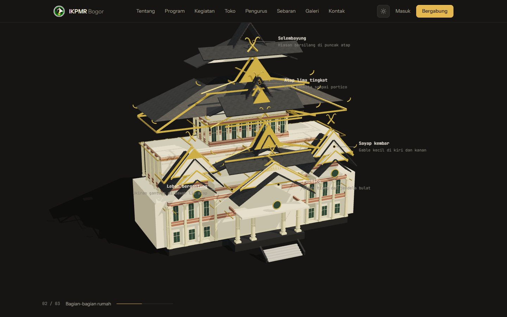
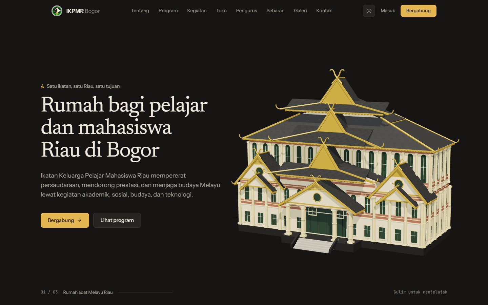
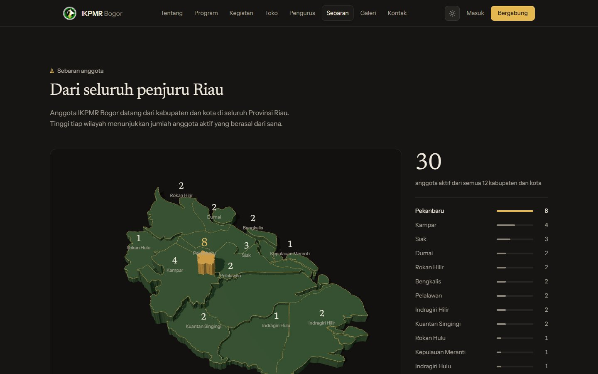
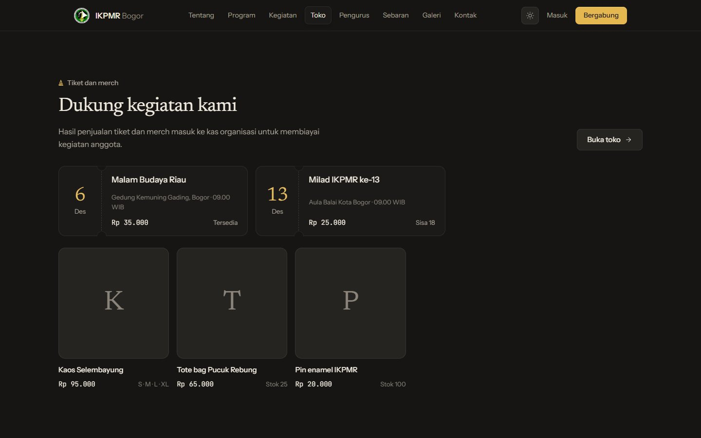
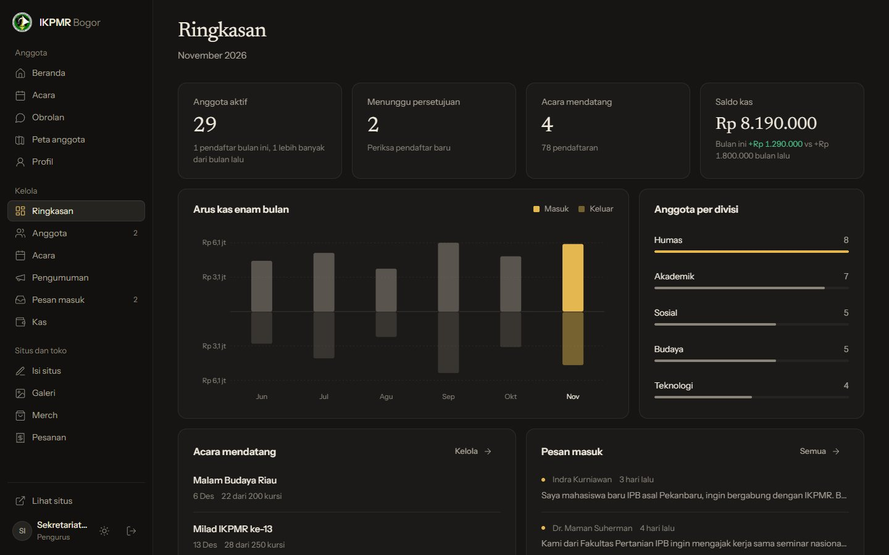
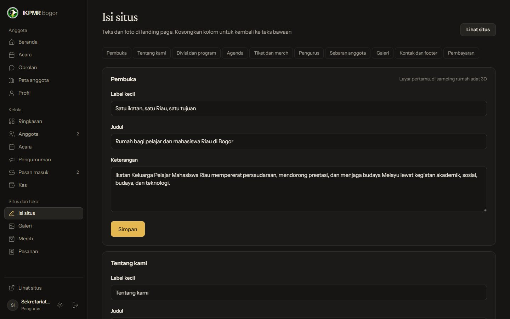
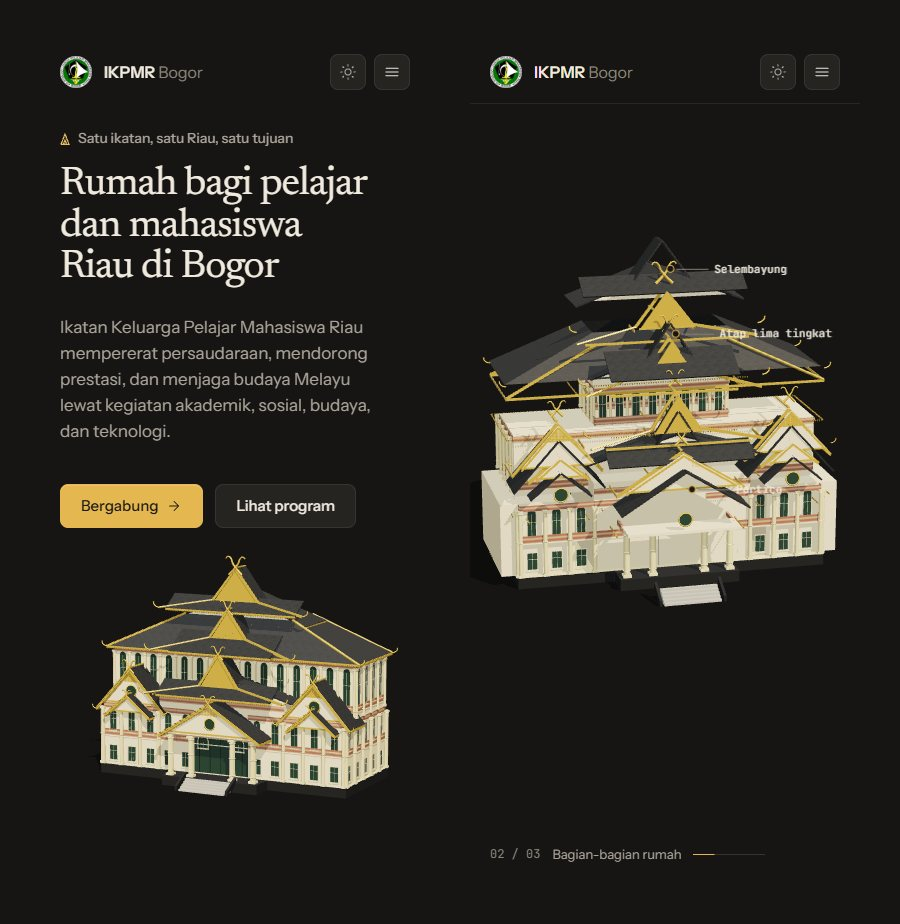

<p align="center">
  
</p>

<h1 align="center">IKPMR Bogor</h1>

<p align="center">
  Situs, ruang anggota, dan toko Ikatan Keluarga Pelajar Mahasiswa Riau di Bogor
  <br>
  <a href="https://ikpmr-bogor.vercel.app"><strong>ikpmr-bogor.vercel.app</strong></a>
</p>

<p align="center">
  
</p>

Satu aplikasi untuk tiga kebutuhan organisasi. Pengunjung mengenal IKPMR lewat landing page dengan rumah adat Melayu Riau 3D yang terurai saat di-scroll. Anggota berkumpul di ruang anggota: agenda, pengumuman, obrolan, dan peta asal daerah. Pengurus mengelola semuanya dari tempat yang sama, termasuk isi situs, kas, serta penjualan tiket dan merch.

## Tampilan

<table>
  <tr>
    <td width="50%"></td>
    <td width="50%"></td>
  </tr>
  <tr>
    <td>Halaman depan dengan rumah adat 3D yang dibangun sepenuhnya dalam kode</td>
    <td>Peta 3D sebaran anggota di 12 kabupaten dan kota Riau, hanya berupa jumlah</td>
  </tr>
  <tr>
    <td></td>
    <td></td>
  </tr>
  <tr>
    <td>Tiket acara dan merch, dibayar lewat transfer atau QRIS</td>
    <td>Ringkasan pengurus: anggota, agenda, kas enam bulan, pesan masuk</td>
  </tr>
  <tr>
    <td></td>
    <td></td>
  </tr>
  <tr>
    <td>Semua teks dan foto landing page bisa diubah pengurus tanpa menyentuh kode</td>
    <td>Di ponsel, rumah adat naik ke tengah layar saat teks terhapus</td>
  </tr>
</table>

## Fitur

**Situs publik**
- Preloader bermotif selembayung dan pucuk rebung yang mengikuti progres muat sebenarnya
- Hero yang disematkan: teks terhapus, kamera mengitari rumah adat, atap terurai lima tingkat dengan label bagian, lalu menyatu kembali
- Program, agenda, pengurus, galeri, dan formulir kontak, semuanya dari database
- Peta 3D sebaran anggota per kabupaten tanpa menampilkan nama
- Mode gelap dan terang, scroll berinersia di desktop, responsif sampai layar 360 px

**Ruang anggota** (`/anggota`)
- Beranda pengumuman dan agenda
- Daftar acara gratis
- Obrolan grup dan pribadi, termasuk kirim foto dan dokumen sampai 4 MB
- Peta anggota dan profil

**Kelola pengurus** (`/anggota/kelola`)
- Persetujuan anggota, jabatan, dan akses kelola
- Acara dengan harga tiket, kuota, dan poster
- Pengumuman, pesan masuk, kas, dan galeri
- Isi situs: semua teks landing page, foto, kontak, rekening, dan QRIS
- Merch dan pesanan: verifikasi bukti transfer, otomatis tercatat di kas, tanda hadir untuk e-tiket

Pengurus masuk lewat halaman yang sama dengan anggota. Menu kelola hanya muncul untuk akun yang diberi akses, dan peran selalu dicek ulang ke database.

**Toko** (`/toko`)
- Tiket acara berbayar dan merch, bisa dipesan tanpa akun
- Stok dan kuota dikurangi secara atomik saat memesan, dan dikembalikan bila pesanan ditolak
- Halaman pesanan dengan petunjuk bayar, unggah bukti, dan e-tiket setelah lunas

## Teknologi

| Bagian | Pilihan |
| --- | --- |
| Framework | Next.js 15 (App Router, server actions), React 19 |
| Autentikasi | Auth.js v5, email dan kata sandi, sesi JWT |
| Database | PostgreSQL di Neon, Prisma 6 |
| 3D | Three.js, model dan peta dibangun dalam kode |
| Penyimpanan file | Vercel Blob, atau `public/uploads` saat lokal |
| Gerak | Lenis untuk scroll, CSS untuk transisi |
| Hosting | Vercel |

## Menjalankan di komputer sendiri

Butuh Node.js 20 atau lebih baru dan sebuah database PostgreSQL.

```bash
npm install
cp .env.example .env        # isi DATABASE_URL, DATABASE_URL_UNPOOLED, AUTH_SECRET
npx prisma migrate deploy
npx prisma db seed          # data contoh: 31 akun, 7 acara, 3 merch
npm run dev                 # http://localhost:3000
```

Akun dari seed lokal:

| Peran | Email | Kata sandi |
| --- | --- | --- |
| Pengurus | `sekretariat@ikpmr.id` | `SEED_ADMIN_PASSWORD`, bawaan `ikpmr-admin-2026` |
| Anggota | `nadia@ikpmr.id` | `SEED_MEMBER_PASSWORD`, bawaan `ikpmr-anggota-2026` |

Kata sandi bawaan hanya untuk database lokal. Untuk database production, jalankan seed dengan `SEED_ADMIN_PASSWORD` dan `SEED_MEMBER_PASSWORD` yang acak, lalu ganti kata sandi setelah masuk pertama kali. Seed menolak jalan kalau database sudah berisi pengguna, kecuali dengan `SEED_FORCE=1`, yang menghapus semua data.

### Variabel lingkungan

| Nama | Wajib | Keterangan |
| --- | --- | --- |
| `DATABASE_URL` | ya | Koneksi pooled ke PostgreSQL |
| `DATABASE_URL_UNPOOLED` | ya | Koneksi langsung, dipakai migrasi |
| `AUTH_SECRET` | ya | Buat dengan `npx auth secret` |
| `BLOB_READ_WRITE_TOKEN` | di Vercel | Tanpa ini semua unggahan di Vercel nonaktif |

## Deploy ke Vercel

Proyek Vercel `ikpmr-bogor` sudah terhubung ke Neon dan Vercel Blob, dan semua variabel di atas sudah terisi. Supaya setiap push ke GitHub langsung ter-deploy:

1. Buat repository kosong di GitHub, lalu dari folder ini:
   ```bash
   git remote add origin https://github.com/NAMA-AKUN/ikpmr-bogor.git
   git push -u origin main
   ```
2. Di Vercel, buka proyek **ikpmr-bogor**, lalu **Settings**, **Git**, **Connect Git Repository**, dan pilih repository tadi.
3. Selesai. Push ke `main` menjadi deploy production, dan branch lain menjadi preview.

Build menjalankan `prisma generate`, `prisma migrate deploy`, lalu `next build`, jadi perubahan skema ikut diterapkan otomatis.

Untuk proyek Vercel baru dari nol: impor repository di vercel.com/new, tambahkan Neon dan Blob dari tab Storage, isi `AUTH_SECRET`, lalu deploy dan jalankan seed sekali dari komputer sendiri.

## Struktur

```
app/
  page.tsx              landing page
  anggota/              ruang anggota, dan kelola/ untuk pengurus
  toko/, pesanan/       toko dan halaman pesanan pembeli
  actions/              server actions: publik, anggota, pengurus, isi situs, toko
  api/chat/             obrolan lewat polling
components/
  landing/              hero, preloader, agenda, pengurus, transisi
  app/                  shell, formulir pengurus, obrolan
  shop/                 kartu tiket dan merch, checkout
lib/
  content.ts            daftar teks dan foto landing page yang bisa diubah
  three/                model rumah adat, peta Riau, adegan hero
  upload.ts             penyimpanan file ke Blob atau lokal
prisma/                 skema, migrasi, seed
```

## Catatan

- Obrolan memakai polling setiap 3 detik ke `/api/chat`, sehingga berjalan di serverless tanpa server websocket.
- Batas kabupaten di peta berasal dari geoBoundaries (BPS, WFP, OCHA ROAP, CC BY 3.0 IGO), dipotong ke 12 wilayah Riau di `lib/riau-geo.json` lewat `scripts/extract-riau.py`.
- Ukuran unggahan dibatasi 4 MB karena Vercel menolak request di atas 4,5 MB.
- Nomor WhatsApp, rekening, QRIS, serta merch dan tiket di seed masih contoh. Ganti lewat Kelola, Isi situs, Merch, dan Acara.
